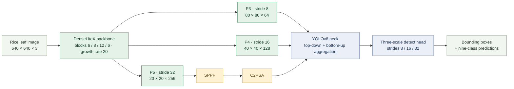
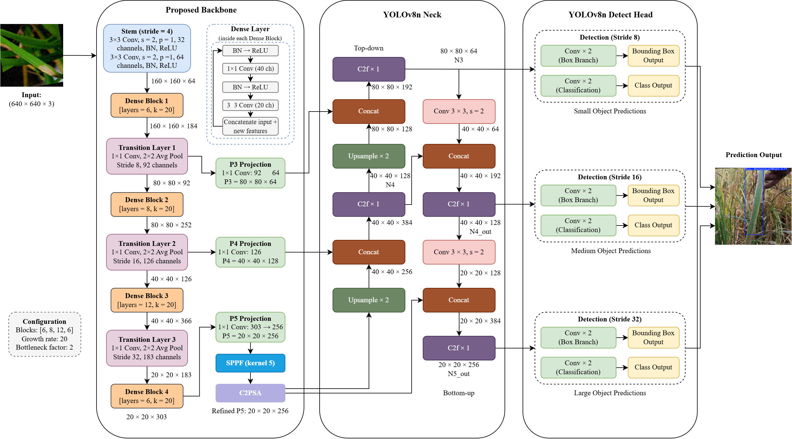
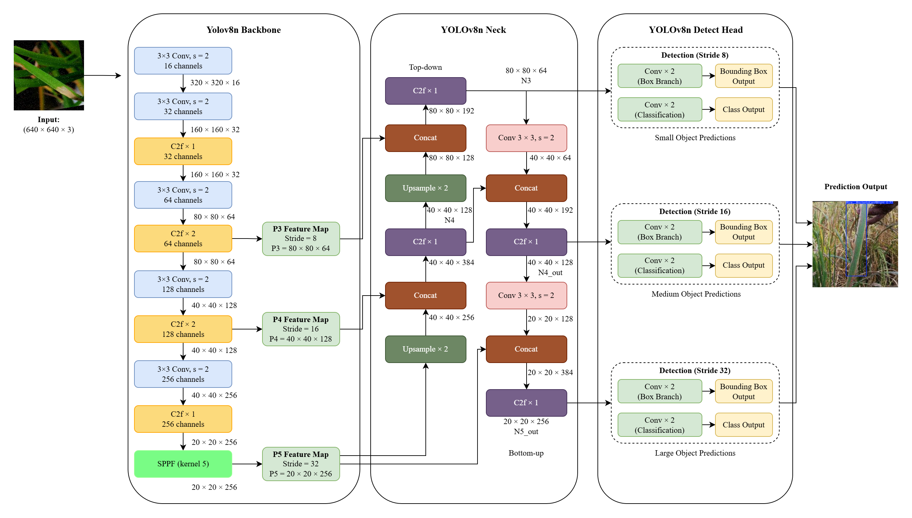
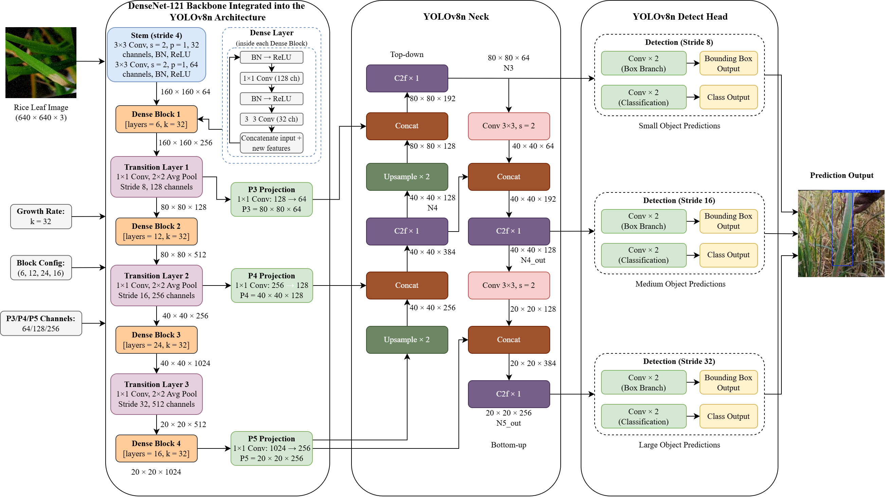

<div align="center">

  

  <p><strong>A lightweight dense backbone for nine-class paddy leaf disease detection.</strong></p>
  <p>Custom model design · controlled architecture comparisons · browser-based inference</p>

  <a href="https://paddylitex.onrender.com/"></a>
  <a href="https://huggingface.co/spaces/Wizzas/PaddyLiteX"></a>
  
  <br />
  
  
  
  
  

  <p>
    <a href="#overview">Overview</a> ·
    <a href="#architecture">Architecture</a> ·
    <a href="#reported-results">Results</a> ·
    <a href="#ablation-studies">Ablations</a> ·
    <a href="#dataset">Dataset</a> ·
    <a href="#quick-start">Quick start</a> ·
    <a href="#interactive-demo">Demo</a>
  </p>

  <p><strong>Wilbert Andrew Yonathan</strong><br />Bachelor of Engineering in Artificial Intelligence · Xiamen University Malaysia</p>

</div>

## Overview

PaddyLiteX studies how to retain useful disease-detection performance while
reducing the cost of a DenseNet121-based YOLOv8n integration. Its proposed
detector combines a custom **DenseLiteX backbone**, **Spatial Pyramid Pooling
Fast (SPPF)** and **C2PSA attention**, followed by a YOLOv8-style neck and
three-scale detection head.

The repository brings together custom model modules, architecture configurations,
training and evaluation scripts, component ablations and an interactive website
for comparing predictions on the same uploaded image.

| Architecture research | Measured comparison | Interactive application |
|---|---|---|
| Reduced dense-block depth, growth rate and bottleneck expansion | Precision, recall, mAP, parameters and GFLOPs | Baseline and proposed predictions on one image |
| DenseLiteX with SPPF and C2PSA refinement | Two baselines and two component-ablation groups | Annotated boxes, metric charts and class-level comparisons |
| P3, P4 and P5 features for three-scale detection | 803 test images and 2,466 annotated objects | Exported ONNX models executed in the browser |

> **The central result:** compared with the evaluated DenseNet121 baseline, the
> proposed detector uses **68.01% fewer parameters** and **72.59% lower reported
> GFLOPs**, with **0.98 percentage points higher mAP@0.5**. This is a measured
> trade-off: it does not outperform every baseline on every metric.

## Architecture

### Proposed detector: DenseLiteX + SPPF + C2PSA

**Model configuration:** `YOLOv8n_DenseLiteX_SPPF_C2PSA`.

The dense backbone reuses features through concatenation. Its three projected
outputs enter the YOLOv8-style feature pyramid; the deepest output is refined by
SPPF and C2PSA before aggregation.



<a href="assets/architecture-denselitex.png"></a>

*Proposed architecture supplied with the thesis. Select the image to inspect the
full-resolution diagram. Diagrams illustrate the design; the model YAMLs and
custom modules define the executable implementation.*

| Component | Proposed configuration | Purpose |
|---|---|---|
| DenseLiteX | Blocks **[6, 8, 12, 6]**; growth rate **20** | Dense feature reuse with reduced backbone size |
| Dense layers | Bottleneck multiplier **2**; dropout **0.0** | Compact intermediate feature transformations |
| Output projections | **64 / 128 / 256 channels** at strides **8 / 16 / 32** | Match the three neck inputs |
| SPPF | Deepest P5 feature map | Spatial context aggregation |
| C2PSA | After SPPF | Attention-based feature refinement |
| Neck | Top-down and bottom-up paths; **C2f × 1** per aggregation block | Fuse features across scales |
| Detection head | Three scales; **nine classes** | Predict bounding boxes and class scores |

**Implementation:** [custom dense modules](ultralytics/nn/modules/densenet.py) ·
[proposed model YAML](cfg/training/yolov8n_denselitex_sppf_c2psa.yaml).

### Baseline architectures

<details>
<summary><strong>Baseline 1 — YOLOv8n</strong> · expand architecture</summary>

The original YOLOv8n detector provides the reference for a compact, conventional
backbone with its feature pyramid and three-scale detection head.

<a href="assets/architecture-yolov8n.png"></a>

[Architecture configuration](cfg/training/yolov8n.yaml).

</details>

<details>
<summary><strong>Baseline 2 — YOLOv8n + DenseNet121</strong> · expand architecture</summary>

This integration uses dense blocks **[6, 12, 24, 16]** and growth rate **32**.
Projected P3/P4/P5 features feed the detection neck. Its larger backbone provides
the principal comparison for the proposed reduction in parameters and GFLOPs.

<a href="assets/architecture-densenet121.png"></a>

[Architecture configuration](cfg/training/yolov8n_densenet121.yaml).

</details>

**Contribution boundary:** DenseLiteX is the backbone configuration developed in
this project. SPPF, C2PSA, dense connectivity and the underlying YOLO components
are existing methods. The thesis evaluates their integration and resulting
performance–complexity trade-off.

## Reported results

Evaluation covers **nine classes**, **803 test images** and **2,466 annotated
objects**. Custom-model results correspond to the updated **C2f × 1**
configurations. Higher precision, recall and mAP are better; lower parameters
and GFLOPs indicate lower reported model complexity.

| Model | Precision (%) | Recall (%) | mAP@0.5 (%) | mAP@0.5:0.95 (%) | Parameters | GFLOPs |
|---|---:|---:|---:|---:|---:|---:|
| YOLOv8n · Baseline 1 | 83.68 | **76.61** | 80.79 | 54.66 | 3,007,403 | **8.1** |
| YOLOv8n + DenseNet121 · Baseline 2 | **84.71** | 74.79 | 80.69 | **56.08** | 9,002,123 | 51.8 |
| **DenseLiteX + SPPF + C2PSA · Proposed** | 83.29 | 75.67 | **81.67** | 55.83 | **2,879,917** | 14.2 |

### What the comparison shows

| Proposed model compared with | mAP@0.5 | mAP@0.5:0.95 | Parameters | Reported GFLOPs |
|---|---:|---:|---:|---:|
| YOLOv8n baseline | +0.88 pp | +1.17 pp | 4.24% fewer | 75.31% higher |
| DenseNet121 baseline | +0.98 pp | −0.25 pp | 68.01% fewer | 72.59% lower |

The proposed model offers lower complexity than the DenseNet121 integration.
Against the original YOLOv8n, it has slightly fewer parameters and higher mAP,
but **higher GFLOPs**, slightly lower precision and slightly lower recall.
GFLOPs do not establish wall-clock inference speed; no measured latency or FPS
advantage is claimed here.

## Ablation studies

### DenseLiteX components

| Configuration | Precision (%) | Recall (%) | mAP@0.5 (%) | mAP@0.5:0.95 (%) | Parameters | GFLOPs |
|---|---:|---:|---:|---:|---:|---:|
| DenseLiteX | 82.67 | 71.84 | 78.82 | 49.16 | 2,467,373 | 13.9 |
| DenseLiteX + SPPF | **83.67** | 73.82 | 79.94 | 53.92 | 2,631,597 | 14.0 |
| DenseLiteX + C2PSA | 78.95 | 73.47 | 78.39 | 50.82 | 2,715,693 | 14.1 |
| **DenseLiteX + SPPF + C2PSA** | 83.29 | **75.67** | **81.67** | **55.83** | 2,879,917 | 14.2 |

The combined configuration leads this group in recall and both mAP metrics.
C2PSA alone reduces mAP@0.5 relative to DenseLiteX, while adding it after SPPF
improves the score. This suggests a possible component interaction; one run per
architecture does not establish a reliable mechanism or statistical significance.

<details>
<summary><strong>DenseNet121 components</strong> · expand the second ablation group</summary>

| Configuration | Precision (%) | Recall (%) | mAP@0.5 (%) | mAP@0.5:0.95 (%) | Parameters | GFLOPs |
|---|---:|---:|---:|---:|---:|---:|
| DenseNet121 | 84.71 | 74.79 | 80.69 | 56.08 | 9,002,123 | 51.8 |
| DenseNet121 + SPPF | 85.46 | 77.80 | 81.92 | 57.18 | 9,166,347 | 51.9 |
| DenseNet121 + C2PSA | **87.19** | 76.51 | **82.55** | 57.75 | 9,250,443 | 52.0 |
| DenseNet121 + SPPF + C2PSA | 83.81 | **79.01** | 82.25 | **58.30** | 9,414,667 | 52.1 |

DenseNet121 + C2PSA has the highest mAP@0.5 in this group; the combined variant
has the highest mAP@0.5:0.95. These variants remain substantially larger than the
proposed model. The proposed detector is selected for its performance–complexity
balance, not the highest score across every evaluated architecture.

</details>

### Evaluation boundaries

- **Single reported run per architecture.** Training-seed variability and
  confidence intervals are unavailable.
- **Percentages versus percentage points.** Metric differences use percentage
  points; parameter and GFLOP changes use relative percentages.
- **Profiling consistency matters.** Parameter and GFLOP values come from the
  reported model summaries. Reproduction should confirm input size, fusion
  policy and operation-counting convention.
- **No timing claim.** Model-forward latency, full-pipeline latency and website
  loading time are different measurements; none is established by the GFLOP table.
- **Completed versus exploratory work.** The tables identify reported evaluations.
  An available YAML does not establish that its experiment was completed.

## Dataset

The task includes **nine labelled classes**, including **Healthy**.

| Class ID | Label |
|---:|---|
| 0 | `Rice__BacterialLeafBlight` |
| 1 | `Rice__BrownSpot` |
| 2 | `Rice__Healthy` |
| 3 | `Rice__Hispa` |
| 4 | `Rice__LeafBlast` |
| 5 | `Rice__LeafScald` |
| 6 | `Rice__LeafSmut` |
| 7 | `Rice__NarrowBrownLeafSpot` |
| 8 | `Rice__NeckBlast` |

| Split | Images / label files | Annotated objects |
|---|---:|---:|
| Training | 5,562 | 17,445 |
| Validation | 1,587 | 5,279 |
| Test | 803 | 2,466 |
| **Total** | **7,952** | **25,190** |

Example source images are available from the
[Rice Leaf Diseases dataset on Kaggle](https://www.kaggle.com/datasets/yusufmurtaza01/rice-leaf-diseases).
Reproducing the reported **detection** results also requires the same bounding-box
annotations and split assignments. Downloading source images alone is insufficient.

<details>
<summary><strong>Expected local dataset layout</strong></summary>

```text
datasets/rice_yolo_split/
├── images/
│   ├── train/
│   ├── val/
│   └── test/
└── labels/
    ├── train/
    ├── val/
    └── test/
```

Each image needs a corresponding YOLO `.txt` label file, with class IDs matching
the table. Edit only the dataset `path:` in [data/paddy.yaml](data/paddy.yaml) to
point to this folder. The supplied configuration contains the author's Windows
path, which must be changed on another machine. Dataset images and trained `.pt`
weights are not included in the research source upload.

</details>

## Quick start

### 1. Clone and prepare the environment

```powershell
git clone https://github.com/WAYTECHG/paddylitex-disease-detection.git
cd paddylitex-disease-detection
```

Reuse the existing `paddy_yolo` environment if available. Otherwise, the following
is an **example Python 3.11 / CUDA 12.1 setup**, not a recovered lockfile of the
original training environment. The version badges refer to this example.

```powershell
conda create -n paddylitex python=3.11 -y
conda activate paddylitex
$env:PYTHONNOUSERSITE = "1"

python -m pip install torch==2.5.1 torchvision==0.20.1 --index-url https://download.pytorch.org/whl/cu121
python -m pip install -r requirements.txt
python -m pip check
```

For different hardware, use the [official PyTorch installation selector](https://pytorch.org/get-started/locally/).
Preserve the versions in an already working research environment where possible.

Verify that Python loads the repository's customized Ultralytics package:

```powershell
python -c "import torch, ultralytics; print('Ultralytics:', ultralytics.__file__); print('CUDA:', torch.cuda.is_available())"
```

The package path should resolve inside this clone. Run commands from the repository
root and retain the custom modules rather than substituting an unrelated pip
Ultralytics installation. Use `--device 0` for a supported GPU or `--device cpu`.

### 2. Train the proposed model

Configure [data/paddy.yaml](data/paddy.yaml) first. This command illustrates
**300 epochs, 640-pixel inputs and seed 42**; consult the original run records
for exact reproduction, including batch size, early stopping and other settings.

```powershell
python train.py --model cfg/training/yolov8n_denselitex_sppf_c2psa.yaml --data data/paddy.yaml --epochs 300 --imgsz 640 --batch 4 --device 0 --seed 42 --name yolov8n_denselitex_sppf_c2psa
```

<details>
<summary><strong>Train the two baselines</strong></summary>

```powershell
python train.py --model cfg/training/yolov8n.yaml --data data/paddy.yaml --epochs 300 --imgsz 640 --batch 4 --device 0 --seed 42 --name yolov8n

python train.py --model cfg/training/yolov8n_densenet121.yaml --data data/paddy.yaml --epochs 300 --imgsz 640 --batch 4 --device 0 --seed 42 --name yolov8n_densenet121
```

The examples initialize from architecture YAMLs without `--pretrained`. Keep
settings consistent across comparisons. For an ablation, substitute its YAML
and choose a distinct run name.

</details>

### 3. Evaluate and predict

```powershell
python test.py --weights runs/train/yolov8n_denselitex_sppf_c2psa/weights/best.pt --data data/paddy.yaml --split test --imgsz 640 --batch 1 --workers 4 --device 0 --name yolov8n_denselitex_sppf_c2psa

python detect.py --weights runs/train/yolov8n_denselitex_sppf_c2psa/weights/best.pt --source datasets/rice_yolo_split/images/test --imgsz 640 --conf 0.25 --device 0 --name proposed_demo
```

Use the actual checkpoint path printed by training: an existing run directory
can cause a numbered suffix. Always pass `--data data/paddy.yaml` to evaluation,
because the script's default dataset filename differs from the committed file.

<details>
<summary><strong>Reproduction and environment notes</strong></summary>

The supplied README records a dependency-resolution dry run for CPython 3.11 on
Windows x86-64 on **12 October 2026**. It did not install dependencies or execute
training/inference. A resolver check is not an end-to-end reproduction.

The optional `benchmark_inference.py` described in the research materials measures
GPU model-forward latency. Add that file to the repository before attempting to
run it, and keep its measurements separate from end-to-end detection latency.
No timing numbers are added to the reported results here.

</details>

## Interactive demo

**[Open Render](https://paddylitex.onrender.com/)** ·
**[Open Hugging Face](https://huggingface.co/spaces/Wizzas/PaddyLiteX)**

The static comparison application runs exported ONNX models **in the visitor's
browser** through ONNX Runtime Web. It supports same-image predictions from
Baseline 1, Baseline 2 and the proposed model, with annotated detections,
aggregate charts, performance–complexity plots, class-level comparisons and
ablation results.

| Research workflow | Browser demonstration |
|---|---|
| Customized Python / Ultralytics implementation | Static HTML, JavaScript and ONNX Runtime Web |
| Train and evaluate `.pt` checkpoints | Execute exported ONNX models |
| Requires the matching dataset, annotations and environment | Requires the exported models and runtime assets |
| Produces the reported evaluation metrics | Displays predictions and previously measured results |

Serve the existing static website locally:

```powershell
python -m http.server 8000 --directory PaddyLiteX_HF_Static
```

Open **http://localhost:8000**. Python research dependencies are unnecessary for
serving the static files; model/runtime assets must still be available for
detection. Updating chart data does not replace an ONNX model. A single uploaded
image produces predictions, not a new measurement of dataset-level mAP.

## Repository guide

| Path | Purpose |
|---|---|
| [cfg/training/](cfg/training/) | Baseline, proposed, ablation and exploratory model YAMLs |
| [ultralytics/](ultralytics/) | Customized framework and dense-backbone implementation |
| [data/paddy.yaml](data/paddy.yaml) | Dataset root and class labels |
| [train.py](train.py) | Training entry point |
| [test.py](test.py) | Validation/test evaluation entry point |
| [detect.py](detect.py) | Local predictions and saved annotations |
| [audit.py](audit.py) | Filename/label consistency inspection; configure its local dataset root |
| [PaddyLiteX_HF_Static/](PaddyLiteX_HF_Static/) | Static demo, evaluation data and browser ONNX assets |
| [requirements.txt](requirements.txt) | Research/runtime dependency definitions |
| [assets/](assets/) | README banner and three architecture diagrams |

## Author and acknowledgments

**Wilbert Andrew Yonathan** · Xiamen University Malaysia  
Bachelor of Engineering in Artificial Intelligence · Final Year Thesis

Project contributions include the custom DenseNet-based detector integration,
DenseLiteX configuration, SPPF/C2PSA experiments, evaluation and comparison demo.
The work builds on [Ultralytics YOLO](https://github.com/ultralytics/ultralytics),
[DenseNet](https://arxiv.org/abs/1608.06993) and
[ONNX Runtime Web](https://onnxruntime.ai/docs/tutorials/web/).
Upstream modules remain credited to their original authors.

## Licensing

See the author's [MIT license](LICENSE) and the bundled
[Ultralytics AGPL-3.0 license](LICENSE-ULTRALYTICS). The root MIT license does not
relicense upstream code. Preserve third-party notices; dataset terms apply
separately to images and annotations.

---

<p align="center"><strong>PaddyLiteX</strong><br />Dense feature reuse. Measured trade-offs. Reproducible research.</p>
