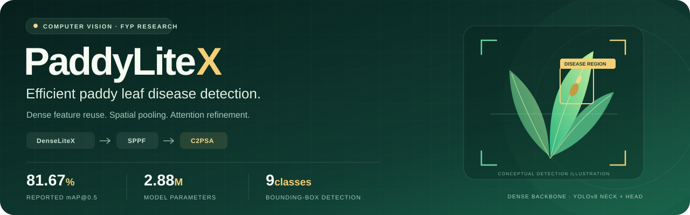

<p align="center">
  
</p>

<p align="center">
  <a href="https://paddylitex.onrender.com/"></a>
  <a href="https://huggingface.co/spaces/Wizzas/PaddyLiteX"></a>
  
</p>

# PaddyLiteX: Efficient Paddy Leaf Disease Detection

**My final year thesis project** for the Bachelor of Engineering in Artificial Intelligence at **Xiamen University Malaysia**, developed by **Wilbert Andrew Yonathan (AIT2309246)**.

PaddyLiteX investigates a lightweight DenseNet-based backbone for nine-class paddy leaf disease detection. The proposed model combines **DenseLiteX, Spatial Pyramid Pooling Fast (SPPF) and C2PSA attention** within a YOLOv8n-based detector. This repository contains the custom model implementation, architecture configurations, training and evaluation scripts, and an interactive comparison website.

**[Try the live demo on Render](https://paddylitex.onrender.com/)** · **[Try it on Hugging Face](https://huggingface.co/spaces/Wizzas/PaddyLiteX)**

## Problem Statement

Paddy leaf disease identification requires distinguishing symptoms that can vary in appearance, size and position within an image. Object detection can identify both the disease category and the affected region, but the detector must balance prediction quality with computational cost.

A DenseNet121-based backbone provides dense feature reuse, but the evaluated integration is substantially larger and more computationally demanding than the original YOLOv8n baseline. This study investigates whether a smaller dense backbone, supported by spatial pooling and attention, can retain useful detection performance while reducing that cost.

## Research Objectives

1. Implement and evaluate YOLOv8n and YOLOv8n_DenseNet121 as detection baselines on the same nine-class paddy dataset.
2. Develop DenseLiteX by reducing dense-block depth, growth rate and bottleneck expansion, and integrate SPPF and C2PSA into the proposed detector.
3. Assess precision, recall, mAP@0.5, mAP@0.5:0.95, parameters and GFLOPs through baseline comparisons and component ablation studies.
4. Present the trained models in a public demo that compares predictions on the same uploaded image and visualizes evaluation results.

## Proposed Method

**YOLOv8n_DenseLiteX_SPPF_C2PSA** uses a custom dense backbone with:

| Component | Configuration / purpose |
|---|---|
| DenseLiteX | Growth rate **20**, dense blocks **[6, 8, 12, 6]**, bottleneck multiplier **2**, dropout **0.0** |
| Backbone outputs | P3/8, P4/16 and P5/32, projected to **64, 128 and 256 channels** |
| SPPF | Spatial pooling on the P5 feature map |
| C2PSA | Attention refinement after SPPF |
| Feature aggregation | YOLOv8-style top-down and bottom-up paths with **one internal C2f repeat** in each aggregation block |
| Detection head | Three-scale detection for **nine classes** |

The custom DenseNet-family implementation is in [`ultralytics/nn/modules/densenet.py`](ultralytics/nn/modules/densenet.py). The final model configuration is [`cfg/training/yolov8n_denselitex_sppf_c2psa.yaml`](cfg/training/yolov8n_denselitex_sppf_c2psa.yaml).

DenseLiteX is the backbone configuration developed in this project. SPPF, C2PSA and the underlying YOLO components are existing methods; this thesis studies their integration and the resulting performance–complexity trade-off.

## Main Results

Reported evaluation uses **803 test images**, **2,466 annotated objects** and **nine classes**. The custom-model results below correspond to the updated **C2f × 1** configurations.

| Model | Role | Precision (%) | Recall (%) | mAP@0.5 (%) | mAP@0.5:0.95 (%) | Parameters | GFLOPs |
|---|---|---:|---:|---:|---:|---:|---:|
| YOLOv8n | Baseline 1 | 83.68 | 76.61 | 80.79 | 54.66 | 3,007,403 | 8.1 |
| YOLOv8n_DenseNet121 | Baseline 2 | 84.71 | 74.79 | 80.69 | 56.08 | 9,002,123 | 51.8 |
| YOLOv8n_DenseLiteX_SPPF_C2PSA | Proposed | 83.29 | 75.67 | 81.67 | 55.83 | 2,879,917 | 14.2 |

Compared with **Baseline 2**, the proposed model achieves:

- **0.98 percentage points higher mAP@0.5**: 80.69% → 81.67%.
- **68.01% fewer parameters**: 9,002,123 → 2,879,917.
- **72.59% lower reported GFLOPs**: 51.8 → 14.2.
- **0.25 percentage points lower mAP@0.5:0.95**: 56.08% → 55.83%.

Compared with **Baseline 1**, the proposed model improves mAP@0.5 by **0.88 percentage points** and mAP@0.5:0.95 by **1.17 percentage points**, with **4.24% fewer parameters**. Its reported GFLOPs are higher, at **14.2 versus 8.1**. The outcome is an efficiency improvement over the DenseNet121-based baseline, rather than a reduction in every cost metric against both baselines.

## Ablation Studies

### DenseLiteX Component Ablation

| Model | Precision (%) | Recall (%) | mAP@0.5 (%) | mAP@0.5:0.95 (%) | Parameters | GFLOPs |
|---|---:|---:|---:|---:|---:|---:|
| YOLOv8n_DenseLiteX | 82.67 | 71.84 | 78.82 | 49.16 | 2,467,373 | 13.9 |
| YOLOv8n_DenseLiteX_SPPF | 83.67 | 73.82 | 79.94 | 53.92 | 2,631,597 | 14.0 |
| YOLOv8n_DenseLiteX_C2PSA | 78.95 | 73.47 | 78.39 | 50.82 | 2,715,693 | 14.1 |
| YOLOv8n_DenseLiteX_SPPF_C2PSA | 83.29 | 75.67 | 81.67 | 55.83 | 2,879,917 | 14.2 |

The combined DenseLiteX + SPPF + C2PSA configuration has the highest mAP@0.5, mAP@0.5:0.95 and recall within this four-model group. C2PSA alone decreases mAP@0.5 relative to DenseLiteX, while its addition after SPPF improves the score. This is consistent with a possible component interaction; the single-run results do not establish its statistical reliability or mechanism.

### DenseNet121 Component Ablation

| Model | Precision (%) | Recall (%) | mAP@0.5 (%) | mAP@0.5:0.95 (%) | Parameters | GFLOPs |
|---|---:|---:|---:|---:|---:|---:|
| YOLOv8n_DenseNet121 | 84.71 | 74.79 | 80.69 | 56.08 | 9,002,123 | 51.8 |
| YOLOv8n_DenseNet121_SPPF | 85.46 | 77.80 | 81.92 | 57.18 | 9,166,347 | 51.9 |
| YOLOv8n_DenseNet121_C2PSA | 87.19 | 76.51 | 82.55 | 57.75 | 9,250,443 | 52.0 |
| YOLOv8n_DenseNet121_SPPF_C2PSA | 83.81 | 79.01 | 82.25 | 58.30 | 9,414,667 | 52.1 |

DenseNet121 + C2PSA achieves the highest mAP@0.5 in this group, while DenseNet121 + SPPF + C2PSA achieves the highest mAP@0.5:0.95. These variants remain substantially larger than the proposed lightweight model. The proposed model is selected for its performance–complexity balance, not because it has the highest score across every evaluated architecture.

**Evaluation notes:** Precision, recall and mAP are shown as percentages. Absolute score differences are expressed in percentage points; parameter/GFLOP changes are relative percentages. Each architecture has one reported experimental run; variability across training seeds is not available. Parameters and GFLOPs are taken from the reported model summaries. Reproduction should confirm a consistent profiling input size, fusion policy and operation-counting convention. No inference-time benchmark results are claimed here yet.

The demo's [`results.json`](PaddyLiteX_HF_Static/results.json) and [`per_class.json`](PaddyLiteX_HF_Static/per_class.json) hold the aggregate and class-level values displayed by the website. These evaluation metrics describe the test set, not the accuracy of a single uploaded image.

## Dataset and Classes

Example images are available from the [Rice Leaf Diseases dataset on Kaggle](https://www.kaggle.com/datasets/yusufmurtaza01/rice-leaf-diseases). Reproducing this project's reported detection results requires the same YOLO bounding-box annotations and train/validation/test split; downloading the source images alone does not recreate them.

| Class ID | Label |
|---:|---|
| 0 | Rice__BacterialLeafBlight |
| 1 | Rice__BrownSpot |
| 2 | Rice__Healthy |
| 3 | Rice__Hispa |
| 4 | Rice__LeafBlast |
| 5 | Rice__LeafScald |
| 6 | Rice__LeafSmut |
| 7 | Rice__NarrowBrownLeafSpot |
| 8 | Rice__NeckBlast |

| Split | Images / label files | Annotated objects |
|---|---:|---:|
| Training | 5,562 | 17,445 |
| Validation | 1,587 | 5,279 |
| Test | 803 | 2,466 |
| **Total** | **7,952** | **25,190** |

Arrange each split under `datasets/rice_yolo_split/images/` and `datasets/rice_yolo_split/labels/`, using `train`, `val` and `test` subfolders. Each image must have its corresponding YOLO `.txt` annotation. Class IDs must match the table above.

Edit **only the dataset `path:` entry** in [`data/paddy.yaml`](data/paddy.yaml) to point to your local `rice_yolo_split` folder. The committed configuration currently contains the author's Windows path, which must be changed on another machine. Dataset images and trained `.pt` weights are not supplied as part of the research source upload.

## Repository Guide

| Path | Purpose |
|---|---|
| `cfg/training/` | Baseline, proposed, ablation and exploratory architecture configurations |
| `data/paddy.yaml` | Dataset locations and disease labels |
| `ultralytics/` | Customized Ultralytics implementation used by the research models |
| `train.py` | Training entry point |
| `test.py` | Validation/test evaluation entry point |
| `detect.py` | Local predictions and saved annotations |
| `audit.py` | Filename-versus-label consistency inspection; edit its dataset root before use |
| `PaddyLiteX_HF_Static/` | Static website, evaluation data and browser ONNX assets |
| `requirements.txt` | Python research/runtime dependencies |
| `assets/paddylitex-banner.svg` | Repository branding |

Exploratory YAMLs represent available configurations, not evidence that every trial was completed. The tables above identify the reported evaluations.

## Run the Research Code Locally

Clone the repository and work from its root:

```powershell
git clone https://github.com/WAYTECHG/paddylitex-disease-detection.git
cd paddylitex-disease-detection
```

Use the existing `paddy_yolo` environment if available. For a separate setup, create a Python 3.11 environment:

```powershell
conda create -n paddylitex python=3.11 -y
conda activate paddylitex
$env:PYTHONNOUSERSITE = "1"
```

Install a matching PyTorch/torchvision build for your hardware first. One published CUDA 12.1 option for Windows/Linux is:

```powershell
python -m pip install torch==2.5.1 torchvision==0.20.1 --index-url https://download.pytorch.org/whl/cu121
python -m pip install -r requirements.txt
python -m pip check
```

Use the [official PyTorch installation instructions](https://pytorch.org/get-started/locally/) for another CUDA/driver combination. Keep a working training environment's original torch/torchvision versions when possible. The dependency ranges are a setup starting point, not a verified lockfile of the original training environment.

The requirements passed a dependency-resolution dry run for CPython 3.11 on Windows x86-64, using Windows environment markers, on 12 October 2026. This check did not install the packages or execute training/inference; verify both locally with the actual checkpoints.

Verify that Python uses this repository's custom package:

```powershell
python -c "import torch, ultralytics; print('Ultralytics:', ultralytics.__file__); print('CUDA:', torch.cuda.is_available())"
```

The Ultralytics path should point inside the cloned repository. Do not replace the custom package with an unrelated pip installation. Run the scripts from the repository root. For GPU training use `--device 0`; for CPU execution use `--device cpu`.

### Train the Three Main Models

These are example commands using 300 epochs, 640-pixel inputs and seed 42. Use the original experiment settings/run records for exact reproduction; batch size, early stopping and other training settings also affect results.

```powershell
python train.py --model cfg/training/yolov8n.yaml --data data/paddy.yaml --epochs 300 --imgsz 640 --batch 4 --device 0 --seed 42 --name yolov8n

python train.py --model cfg/training/yolov8n_densenet121.yaml --data data/paddy.yaml --epochs 300 --imgsz 640 --batch 4 --device 0 --seed 42 --name yolov8n_densenet121

python train.py --model cfg/training/yolov8n_denselitex_sppf_c2psa.yaml --data data/paddy.yaml --epochs 300 --imgsz 640 --batch 4 --device 0 --seed 42 --name yolov8n_denselitex_sppf_c2psa
```

The examples initialize from architecture YAMLs without the `--pretrained` flag. Keep training settings consistent when comparing architectures. For an ablation, substitute its YAML path and give it a distinct run name.

### Evaluate a Trained Checkpoint

```powershell
python test.py --weights runs/train/yolov8n_denselitex_sppf_c2psa/weights/best.pt --data data/paddy.yaml --split test --imgsz 640 --batch 1 --workers 4 --device 0 --name yolov8n_denselitex_sppf_c2psa
```

Use the actual checkpoint path printed by training; existing experiment folders may cause Ultralytics to append a number to the run name. The scripts' default dataset filename differs from the committed `paddy.yaml`, so explicitly pass `--data data/paddy.yaml`.

### Run Local Detection

```powershell
python detect.py --weights runs/train/yolov8n_denselitex_sppf_c2psa/weights/best.pt --source datasets/rice_yolo_split/images/test --imgsz 640 --conf 0.25 --device 0 --name proposed_demo
```

The optional `benchmark_inference.py` supplied with the project measures GPU model-forward latency; add it to the repository before running it. Keep its results separate from website loading time and full detection-pipeline latency.

## Interactive Demo

The public demo allows visitors to upload one image and compare **Baseline 1, Baseline 2 and the proposed model**. It includes annotated predictions, aggregate metric charts, adjustable performance–complexity scatter plots, class-level comparisons and ablation results.

The current static demo executes exported ONNX models **in the visitor's browser** through ONNX Runtime Web. Python research dependencies are not required to serve the static site. The `.pt` files are used by the research workflow; changing charts does not replace the ONNX detection models.

Run the static demo locally:

```powershell
python -m http.server 8000 --directory PaddyLiteX_HF_Static
```

Open **http://localhost:8000**. Model assets/runtime downloads must be available for detection. The live sites are demonstration tools; uploaded predictions require interpretation and do not measure image-level mAP.

## Author and Acknowledgments

**Wilbert Andrew Yonathan** · AIT2309246 · Xiamen University Malaysia

GitHub: [WAYTECHG](https://github.com/WAYTECHG)

My contributions include the custom DenseNet-based detector integration, DenseLiteX configuration, SPPF/C2PSA experiments, model evaluation and the PaddyLiteX comparison demo. The project builds on [Ultralytics YOLO](https://github.com/ultralytics/ultralytics), the [DenseNet architecture](https://arxiv.org/abs/1608.06993) and [ONNX Runtime Web](https://onnxruntime.ai/docs/tutorials/web/). Existing upstream modules remain credited to their original authors.

## Licensing

The repository contains the author's [MIT licence](LICENSE). Bundled Ultralytics code retains its upstream **AGPL-3.0** terms, included in [LICENSE-ULTRALYTICS](LICENSE-ULTRALYTICS); the root MIT file does not relicense third-party code. Preserve the applicable upstream notices when redistributing the implementation. Dataset terms apply separately to images and annotations.
